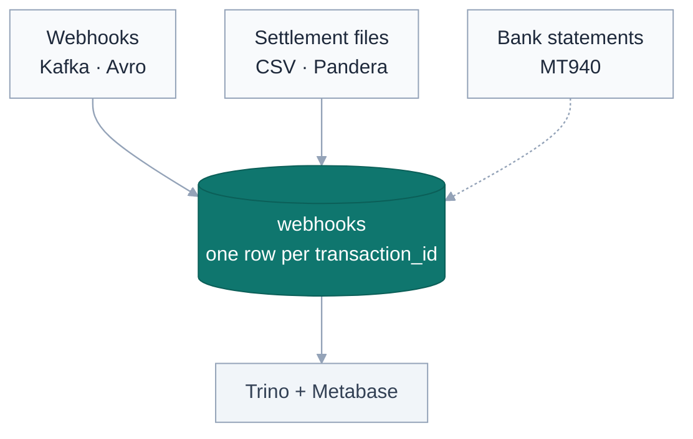
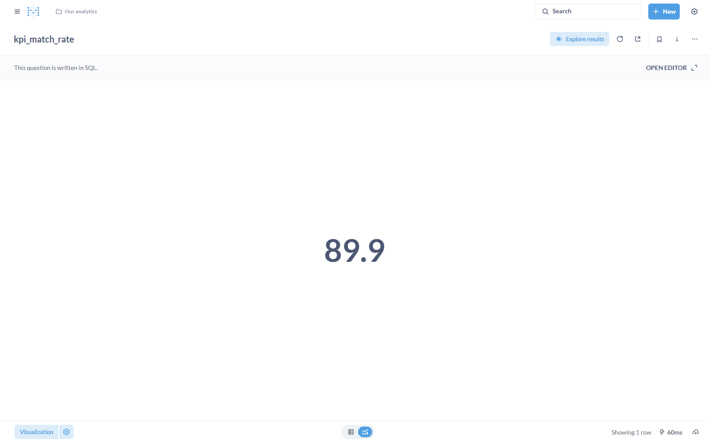
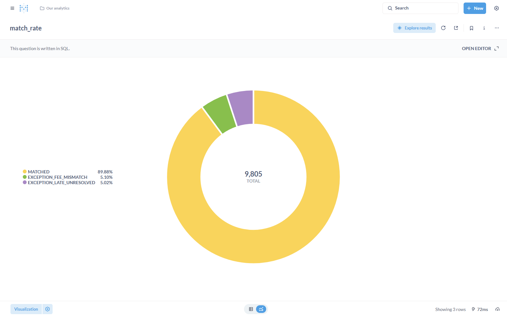

<div align="center">


# Transaction Reconciliation

Local lakehouse pipeline that matches payment gateway webhooks against bank settlement files.

[](https://github.com/DhanushPillay/tx-recon/actions/workflows/ci.yml)
[](https://codecov.io/gh/DhanushPillay/tx-recon)
[](https://www.python.org)

</div>

## What this is

A pipeline that solves one problem: the gateway says it collected Rs.X, the bank says it settled Rs.Y, and the difference should equal the fee (MDR + GST). If it does not, something needs investigation.

**The problem in numbers:** every online payment creates two records, the gateway's webhook ("we collected Rs.1,000") and the bank's settlement file days later ("we settled Rs.976.40"). The gap is the Merchant Discount Rate (MDR, the gateway's cut) plus GST on that fee. Finance teams match these by hand to catch overcharging and delayed closes.

**How tx-recon works:** it streams webhooks into an Iceberg table, validates the daily settlement CSV, and joins the two with an Iceberg MERGE that marks each payment as MATCHED, EXCEPTION_FEE_MISMATCH, or EXCEPTION_MISSING_WEBHOOK.

## Worked example

A Rs.1,000 (100,000 paise) credit card payment at the default rate:

```
fee_before_gst = (100000 * 200 + 5000) // 10000 = 2000   (Rs.20, 2% MDR)
gst_paise      = (2000 * 1800 + 5000) // 10000   = 360    (Rs.3.60, 18% GST on fee)
net_paise      = 100000 - 2360                     = 97640  (Rs.976.40)
```

If the settlement file says Rs.976.40, the transaction is `MATCHED`. If it says Rs.970.00, it is `EXCEPTION_FEE_MISMATCH`. If there is no webhook for that transaction, it is `EXCEPTION_MISSING_WEBHOOK`.

## How it works



Two writers and one evidence leg converge on one table. The streaming lane decodes webhooks, deduplicates them, refuses a batch when the producer's schema id drifts, and parks undecodable rows in a DLQ. The daily batch validates the settlement file, opens a WAP branch, runs the MERGE, ages unresolved rows, and publishes to `main` only when the match-rate and residual gates pass. A failed gate drops the branch.

Gateway webhooks say what was collected, settlement files say what the provider will pay out, and MT940 bank statements provide independent evidence that the money actually arrived. Without the bank leg, a gateway-consistent error can look `MATCHED` and still be wrong.

Every batch is a branch. Writes land on `ingest/YYYY-MM-DD`; readers only see `main` after the gate passes. All merges are idempotent, so re-runs converge instead of duplicating. Bucket partitioning keeps both sides of the MERGE join in the same bucket.

`RECONCILIATION_STATUS`: `MATCHED`, `EXCEPTION_FEE_MISMATCH`, `EXCEPTION_MISSING_WEBHOOK`, `EXCEPTION_MISSING_BANK_STATEMENT`, `EXCEPTION_DUPLICATE_SETTLEMENT`, `EXCEPTION_DUPLICATE_WEBHOOK`, `EXCEPTION_INVALID`, `EXCEPTION_CURRENCY_MISMATCH`, `EXCEPTION_LATE_UNRESOLVED`, `EXCEPTION_REVERSAL`, `PENDING_RECONCILIATION`. What each one means is in [docs/DATA_DICTIONARY.md](docs/DATA_DICTIONARY.md).

Single node (0$): `SPARK_MODE=local` runs Spark on `local[*]` with MinIO, Nessie, Redpanda, and Trino in Docker. LocalStack Terraform proves the cloud IaC without a bill; the same code deploys to S3 + Glue, KMS, and lifecycle policies.

Full architecture: [docs/ARCHITECTURE.md](docs/ARCHITECTURE.md).

## Quickstart

```bash
cp .env.example .env          # ships working local MinIO credentials
docker compose up -d          # redpanda, minio, nessie, trino, metabase
pip install -e ".[dev]"
python -m src.pipeline --date 2026-09-04
```

Then query the reconciled table via Trino (`http://localhost:8080`) or Metabase (`http://localhost:3001`, add Trino: host `trino`, port `8080`, catalog `nessie`, schema `db`). Full setup and the complete command list: [docs/LOCAL_SETUP.md](docs/LOCAL_SETUP.md#make-targets).

## Configuration

Every knob is declared in [.env.example](.env.example) with a comment saying what it does and what breaks when it is wrong. A contract test fails if the code reads a variable that file does not declare, so a knob added to the code cannot ship undocumented.

## What it handles

- **Exact fee math.** Integer-only paise arithmetic, versioned rate cards with effective dates, per-merchant overrides, and a differential test that proves the Python and Spark SQL implementations agree across the full instrument × merchant × date × amount grid.
- **Three independent legs.** Gateway webhooks, provider settlement files (Razorpay, Cashfree, PayU), and MT940 bank statements. When the third leg runs, a `MATCHED` row needs independent bank evidence.
- **Provider batch identity.** Reconcile by provider batch rather than calendar date, with per-provider lag and one global late-SLA threshold, so cut-offs do not create false missing-webhook exceptions.
- **Fail-closed ingestion.** Streaming dedup, schema-id drift detection, a supervised restart loop, and a DLQ for rows that cannot be decoded.
- **Validation before Spark.** Pandera contracts, quarantine, an issuer-prefixed Luhn PAN guard, and a content-hash file registry.
- **Gated publishing.** WAP branches, match-rate and residual SLO gates, and idempotent MERGEs that make re-runs converge.
- **Maker-checker corrections.** An append-only journal; DLQ replay requires a reason and an approver.
- **Evidence, not vibes.** A 41-case hand-labelled answer key, a 10k sample-mix gate, and a 12.6M-row real-data benchmark.

## Results

### Dashboard

Trino serves the reconciled Iceberg tables; Metabase visualizes them. The mart is ready for BI queries.

```sql
SELECT reconciliation_status, COUNT(*), SUM(amount_paise) / 100.0 AS rupees
FROM nessie.db.webhooks
GROUP BY reconciliation_status;
```




Full tour of all 11 cards: [docs/DASHBOARD.md](docs/DASHBOARD.md).

### Benchmarks

Measured on real data: [thiru1711/Financial_Transactions](https://huggingface.co/datasets/thiru1711/Financial_Transactions)
(13,305,915 card transactions) on 9 Oct 2026. Method, repro commands, and full tables: [docs/REAL_DATA.md](docs/REAL_DATA.md).

| Suite | Result |
| :--- | :--- |
| Iceberg MERGE (single-node, 8g driver, 128 shuffles ≥5M) | 1M 50% **11.21s**, 5M 50% **19.81s**, 12M 50% **34.32s** (10%: 3.09 / 12.0 / 18.69s; bench slices ~94.7% due to tx-ordered sampling; end-to-end 89.98% — see below) |
| Validation, 12.9M rows | polars **7.07M** / manual 2.93M / pandera 1.24M / pydantic 132k rows/sec |
| Kafka producer (real ~150B records, acks=all, lz4) | **224,237 msgs/sec**; serial p50 0.75ms, p99 2.82ms |
| Streaming ingestion (Kafka → Iceberg, 16 partitions) | **12,832 rows/sec** sustained over 120s |
| Full-run mix, 12.9M rows | **94.71%** match rate (mix gate ≥85%) |
| End-to-end batch (12.6M rows: validate + MERGE + mart) | **~5 min wall** (173s validate, 105s MERGE, 89.98% end-to-end) |

The loader injects ~10% exceptions by design (health gate ≥ 85%): bench slices show ~94.7% due to tx-ordered sampling, while the full 12.6M end-to-end run reports **89.98%** (11,368,871 / 12,635,227) — both are the mix working, not matcher error. The artifact behind every figure, including the ones that no longer have one, is recorded in [docs/BENCHMARKS.md](docs/BENCHMARKS.md).

## Status

Shipped: gated WAP batches with match-rate and late-SLA enforcement, the bank third leg, DLQ replay with maker-checker, PAN guard and file registry, provider-normalized settlements, the BI mart, and a 12.6M-row scale proof. CI blocks on unit and integration suites, coverage floors, `pip-audit` against a reviewed baseline, secret scanning, and Terraform checks.

Not built: Kubernetes manifests. Compose is the supported deployment path.

Security and secret handling: [SECURITY.md](SECURITY.md).

## License

CC BY 4.0 — see [LICENSE](LICENSE). Original code, docs, figures
(`docs/fig/`) and aggregate metrics are yours to share/adapt with
attribution. Excluded: third-party-derived data files
(`data/real_thiru_full_*`, `data/samples/real_10k_*`,
`data/settlement_*.csv`, `data/curated_*.csv`) — unlicensed upstream,
never redistributed (see `SECURITY.md`); only aggregate counts are published.
