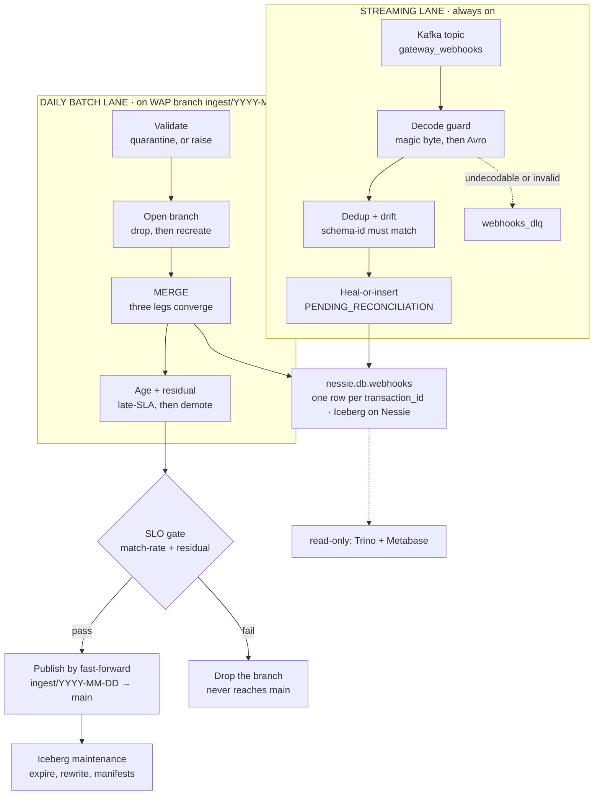

<div align="center">


# Transaction Reconciliation

Local lakehouse pipeline that matches payment gateway webhooks against bank settlement files.

[](https://github.com/DhanushPillay/tx-recon/actions/workflows/ci.yml)
[](https://codecov.io/gh/DhanushPillay/tx-recon)
[](https://www.python.org)

</div>

## What this is

A pipeline that solves one problem: the gateway says it collected Rs.X, the bank says it settled Rs.Y, and the difference should equal the fee (MDR + GST). If it does not, something needs investigation.

**The problem in numbers:** every online payment creates two records, the gateway's webhook ("we collected Rs.1,000") and the bank's settlement file days later ("we settled Rs.976.40"). The gap is the Merchant Discount Rate (MDR, the gateway's cut) plus GST on that fee. Finance teams match these by hand to catch overcharging and delayed closes.

**How tx-recon works:** it streams webhooks into an Iceberg table, validates the daily settlement CSV, and joins the two with an Iceberg MERGE that marks each payment as MATCHED, EXCEPTION_FEE_MISMATCH, or EXCEPTION_MISSING_WEBHOOK.

## Worked example

A Rs.1,000 (100,000 paise) credit card payment at the default rate (`config/fee_rates.yaml`):

```
fee_before_gst = (100000 * 200 + 5000) // 10000 = 2000   (Rs.20, 2% MDR)
gst_paise      = (2000 * 1800 + 5000) // 10000   = 360    (Rs.3.60, 18% GST on fee)
net_paise      = 100000 - 2360                     = 97640  (Rs.976.40)
```

If the settlement file says Rs.976.40, the transaction is `MATCHED`. If it says Rs.970.00, it is `EXCEPTION_FEE_MISMATCH`. If there is no webhook for that transaction, it is `EXCEPTION_MISSING_WEBHOOK`.

## Quickstart

```bash
cp .env.example .env          # ships working local MinIO credentials
docker compose up -d          # redpanda, minio, nessie, trino, metabase
pip install -e ".[dev]"
python -m src.pipeline --date 2026-09-04
```

Then query the reconciled table via Trino (`http://localhost:8080`) or
Metabase (`http://localhost:3001`, add Trino: host `trino`, port `8080`,
catalog `nessie`, schema `db`). Full setup: [docs/LOCAL_SETUP.md](docs/LOCAL_SETUP.md).

## Configuration

Every knob is declared in [.env.example](.env.example) with a comment saying what it
does and what breaks when it is wrong. Start with `cp .env.example .env` and change what
you need; nothing is read from anywhere else. A contract test fails if `src/` or
`scripts/` reads a variable that file does not declare, so a knob added to the code
cannot ship undocumented.

## Make targets

`make help` prints this list from the Makefile itself.

| Command | What it does |
| --- | --- |
| `make install` | `uv sync --extra dev`, so the venv matches `uv.lock` |
| `make lock` | re-resolve `uv.lock` from `pyproject.toml` |
| `make up` | `docker compose up -d`: redpanda, minio, nessie, trino, metabase |
| `make wait` | block until minio, nessie and trino answer |
| `make down` | `docker compose down -v`, which deletes the named volumes |
| `make format` | `ruff format` over `src/ tests/ dags/` |
| `make lint` | `ruff check` over the same three |
| `make typecheck` | `mypy src/` |
| `make test` | unit suite, `-m "not integration"`, xdist |
| `make coverage` | the same suite with the 90% branch gate |
| `make integration` | docker-backed integration suite; waits for the services first |
| `make pipeline` | one daily batch, `DATE=YYYY-MM-DD`, today by default |
| `make accuracy` | sample-mix check over the checked-in 10k sample (not an accuracy gate) |
| `make regression` | gate that run against `tests/performance/baseline_real.json`, mix family only |
| `make bench` | the four real-data benchmark suites |
| `make regression-full` | gate kafka, latency and iceberg too; run `make bench` first |
| `make clean` | remove `__pycache__` and `.pyc` |
| `make help` | the list above |

`make down` is the full reset: it takes redpanda's topics, MinIO's objects, Trino's local
files and the Metabase database with it. Nessie is on no volume at all, so even a plain
`docker compose down` loses the Iceberg catalog and the pipeline has to re-run ingest.

## Architecture



`RECONCILIATION_STATUS`: `MATCHED`, `EXCEPTION_FEE_MISMATCH`, `EXCEPTION_MISSING_WEBHOOK`, `EXCEPTION_MISSING_BANK_STATEMENT`, `EXCEPTION_DUPLICATE_SETTLEMENT`, `EXCEPTION_DUPLICATE_WEBHOOK`, `EXCEPTION_INVALID`, `EXCEPTION_CURRENCY_MISMATCH`, `EXCEPTION_LATE_UNRESOLVED`, `EXCEPTION_REVERSAL`, `PENDING_RECONCILIATION`. What each one means is in [docs/DATA_DICTIONARY.md](docs/DATA_DICTIONARY.md).

Two lanes, one table. Every batch lands on its own branch; nothing touches `main` until the gate passes, and a schema-id mismatch refuses the whole streaming batch.

Single node (0$): `SPARK_MODE=local` (`local[*]`, host driver + MinIO/Nessie/Redpanda/Trino via `docker compose up -d`). Terraform `infra/terraform/local` (LocalStack) proves cloud IaC without bill; same code deploys to `infra/terraform` (S3+Glue, KMS, lifecycle).

Three legs converge on one table. Streaming ingests webhooks. Batch validates settlements (PAN guard + content-hash registry) and merges on a WAP branch, by provider batch rather than calendar date. The bank leg (MT940 via `mt-940`) provides independent evidence for MATCHED rows — a gateway-consistent error is invisible without it. All merges are idempotent so re-runs converge.

Full architecture: [docs/ARCHITECTURE.md](docs/ARCHITECTURE.md).

## Features

- Integer-only paise math in both Python and Spark SQL, no floating-point drift (`src/processing/fee_engine.py`)
- Versioned rate cards with effective-date ranges so historical settlements use the rates that were active when they settled (`config/fee_rates.yaml`)
- Per-merchant negotiated rates that override instrument rates within each card
- Merchant-aware MERGE SQL that checks `merchant_id` before `instrument_type` (`src/processing/reconcile.py: build_fee_case_sql`)
- PG settlement adapters that normalize Razorpay, Cashfree, and PayU CSVs to a canonical 13-column shape including `provider` (`src/adapters/settlement.py`, `config/providers.yaml`)
- Provider batch identity + per-provider lag + one global late-SLA threshold (`config/providers.yaml`, `src/processing/batches.py`) — reconcile by `{provider}:{batch_date}`, so cut-offs do not create false MISSINGs
- Bank-statement third leg: MT940 parsing via `mt-940` (never hand-rolled) with independent credit evidence for MATCHED rows (`src/adapters/bank_statement.py`, `EXCEPTION_MISSING_BANK_STATEMENT`)
- Pandera contract validation with quarantine + no-PAN gate (issuer-prefixed Luhn) + content-hash file registry before Spark (`src/validation/pan_guard.py`, `file_registry.py`)
- WAP branches (`src/processing/wap.py`): batches land on `ingest/YYYY-MM-DD`, merge to `main` only on gate pass (`spark.wap.branch` + `write.wap.enabled` both required, verified live against Nessie 0.107.9 API v2)
- Bucket partitioning `PARTITIONED BY bucket(16, transaction_id)` so MERGE join keys land in the same bucket on both sides. This colocates writes and reduces the shuffle; it does not prune the target scan, because a `MERGE ... ON a = b` equi-condition is a join predicate rather than a scan filter (`src/ingestion/ingest_webhooks.py: ensure_webhook_table`)
- Per-micro-batch `dropDuplicates` plus an idempotent `MERGE WHEN NOT MATCHED` for cross-batch idempotency, with schema-id drift detection that fails closed and a supervisor loop that restarts a dead stream with backoff
- Append-only corrections journal with maker-checker (`src/processing/corrections.py`, `scripts/replay_dlq.py --reason/--approved-by`)
- Fail-closed where it is cheap: `strict_slo` and `ALLOW_DESTRUCTIVE_SEED` default to on/false respectively. Off by default and off by design: `REQUIRE_KAFKA_SASL` and `REQUIRE_SCHEMA_REGISTRY` both default `false`, because a local Redpanda has no SASL to require — see [SECURITY.md](SECURITY.md)
- Differential test proving `FeeEngine` and its Spark SQL mirror agree over the full instrument × merchant × date × amount grid, on generated rate cards, in the default test pass (`tests/processing/test_fee_sql_parity.py`)
- Downgrade-only residual scorer with a property test that false positives never increase (`docs/PROOF.md`)
- Hand-labelled reconciliation fixture: 41 cases with a written reason for each expected status, checked against the MERGE's own arms (`tests/fixtures/recon_cases.yaml`), plus a second tier that runs the real `MERGE INTO` end to end (`tests/processing/test_recon_cases_integration.py`)
- Sample-mix gate on the 10k real sample: confirms the checked-in fixture still holds 8,813 / 500 / 492 and a 94.63% mix match rate. It measures the mix, not fee-engine accuracy — the correctness gate is the labelled fixture above (`tests/performance/recon_accuracy.py`)

## Dashboard

Trino serves the reconciled Iceberg tables; Metabase visualizes them.
BI-ready mart: [sql/marts/fact_reconciliation.sql](sql/marts/fact_reconciliation.sql).

```sql
SELECT reconciliation_status, COUNT(*), SUM(amount_paise) / 100.0 AS rupees
FROM nessie.db.webhooks
GROUP BY reconciliation_status;
```


Full tour of all 11 cards: [docs/DASHBOARD.md](docs/DASHBOARD.md).

## Benchmarks

Measured on real data: [thiru1711/Financial_Transactions](https://huggingface.co/datasets/thiru1711/Financial_Transactions)
(13,305,915 card transactions) on 9 Oct 2026. Method, repro commands, and full tables: [docs/REAL_DATA.md](docs/REAL_DATA.md).

| Suite | Result |
| :--- | :--- |
| Iceberg MERGE (single-node, 8g driver, 128 shuffles ≥5M) | 1M 50% **11.21s**, 5M 50% **19.81s**, 12M 50% **34.32s** (10%: 3.09 / 12.0 / 18.69s; bench slices ~94.7% due to tx-ordered sampling; end-to-end 89.98% — see below) |
| Validation, 12.9M rows | polars **7.07M** / manual 2.93M / pandera 1.24M / pydantic 132k rows/sec |
| Kafka producer (real ~150B records, acks=all, lz4) | **224,237 msgs/sec**; serial p50 0.75ms, p99 2.82ms |
| Streaming ingestion (Kafka → Iceberg, 16 partitions) | **12,832 rows/sec** sustained over 120s |
| Full-run mix, 12.9M rows | **94.71%** match rate (mix gate ≥85%) |
| End-to-end batch (12.6M rows: validate + MERGE + mart) | **~5 min wall** (173s validate, 105s MERGE, 89.98% end-to-end) |

Record: `tests/performance/results_real.json`. The loader injects ~10% exceptions by design (health gate ≥ 85%): bench slices show ~94.7% due to tx-ordered sampling, while the full 12.6M end-to-end run reports **89.98%** (11,368,871 / 12,635,227) — both are the mix working, not matcher error.
Synthetic regression baselines are archived in [docs/BENCHMARKS.md](docs/BENCHMARKS.md).

## Project structure

```
src/
  adapters/        PG settlement normalizers (Razorpay/Cashfree/PayU/Generic) + bank_statement MT940 + real_data loader
  common/          Settings (strict flags, *_FILE secrets), Spark session, domain contracts
  ingestion/       Spark streaming Kafka -> Iceberg (+DLQ, per-row decode guard, supervisor loop, bucket 16)
  processing/      FeeEngine + MERGE reconciliation + residual scorer + batches (provider windows) + wap (branches) + corrections (journal)
  validation/      Pandera schemas + quarantine + pan_guard (issuer-prefixed Luhn) + file_registry (sha256)
  pipeline.py      WAP branch -> validate (PAN/registry) -> reconcile (bank leg, mart, metrics) -> maintenance (fail-closed)
config/
  fee_rates.yaml   versioned rate cards (effective_from/to, merchant overrides)
  providers.yaml   per-provider lag_days / cutoff + a global late_sla_days
sql/marts/         fact_reconciliation mart (migrations/V*__fact_reconciliation.sql is source of truth)
```

## Security

Deployment and secret-handling notes: [SECURITY.md](SECURITY.md).

## Status

Shipped: `fact_reconciliation` TABLE mart (migration-sourced), DLQ replay with maker-checker
(`scripts/replay_dlq.py --reason --approved-by`), match-rate SLO (`MATCH_RATE_SLO` strict fail-closed),
late SLA (global `LATE_SLA_DAYS` threshold → `LATE_UNRESOLVED`, aging rows from earlier batches too),
bucket(16) partitioning, WAP branch isolation (`src/processing/wap.py`), bank third leg (MT940 via `mt-940` → `EXCEPTION_MISSING_BANK_STATEMENT`),
PAN guard + file registry, `provider` canonical column, bucketed maintenance order (expire → orphan 3d → binpack → manifests),
real-data scale proof (12.6M rows). CI: `pip-audit` blocking with a reviewed, dated ignore list.

Not built: Kubernetes manifests. Compose is the supported deployment path.

## License

No license is granted. This is a private portfolio project.
